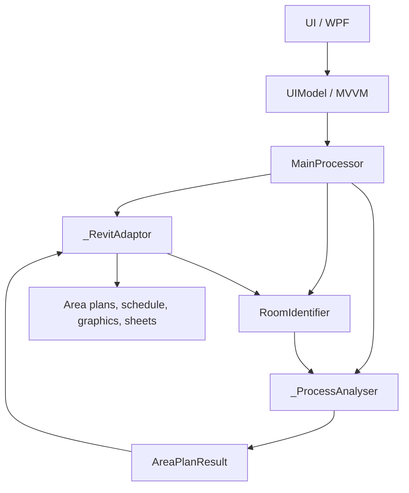

# AreaPlan — Revit Area Analysis Automation

## Status
Architecture specification and project scaffolding. No claim of production-ready Revit implementation.

## Modules
- **MainProcessor**: Orchestrates steps, validation, error handling, TransactionGroup and reporting.
- **UI**: WPF configuration and progress window.
- **UIModel**: MVVM state, commands, settings and validation.
- **_RevitAdaptor**: Encapsulates Revit API: AreaScheme/Level, ViewPlan.CreateAreaPlan, parameter assignment, Area/Room collection, schedule creation, graphic overrides, Viewport and ScheduleSheetInstance positioning.
- **RoomIdentifier**: Maps Rooms to Areas, identifies building rooms and classifies finished vs unfinished spaces by configurable rules.
- **_ProcessAnalyser**: Pure calculations for area totals, classifications, building coverage, consistency checks.
- **Models**: Immutable input/output DTOs for levels, rooms, classifications, summaries, coverage and sheet layout.

## Workflow
1. Validate document, schemes, levels, parameters and templates.
2. Create one area plan per level plus building coverage plan.
3. Set parameters and view properties.
4. Identify rooms and boundaries.
5. Classify finished and unfinished areas.
6. Compute area-plan and building coverage metrics.
7. Populate area-plan table/schedule.
8. Visualize finished areas per level and building coverage.
9. Place views and schedule on sheet(s).
10. Set positions and align viewports.

## Architecture


## Proposed folder layout
```
AreaPlan/
  MainProcessor/AreaPlanProcessor.cs
  UI/AreaPlanWindow.xaml
  UIModel/AreaPlanViewModel.cs
  UIModel/AreaPlanSettings.cs
  _RevitAdaptor/ViewPlanAdaptor.cs
  _RevitAdaptor/ParameterAdaptor.cs
  _RevitAdaptor/RoomAdaptor.cs
  _RevitAdaptor/ScheduleAdaptor.cs
  _RevitAdaptor/VisualizationAdaptor.cs
  _RevitAdaptor/SheetAdaptor.cs
  _ProcessAnalyser/AreaPlanAnalyser.cs
  _ProcessAnalyser/CoverageAnalyser.cs
  RoomIdentifier/RoomIdentifier.cs
  RoomIdentifier/AreaClassificationRules.cs
  Models/AreaPlanResult.cs
```

## Design constraints
Revit API modifications require transactions. Keep calculations separate from API wrappers for testability. Specify whether building coverage uses a dedicated AreaScheme. Ensure sheet alignment accounts for viewport outline and schedule placement. Make the workflow idempotent where practical.
